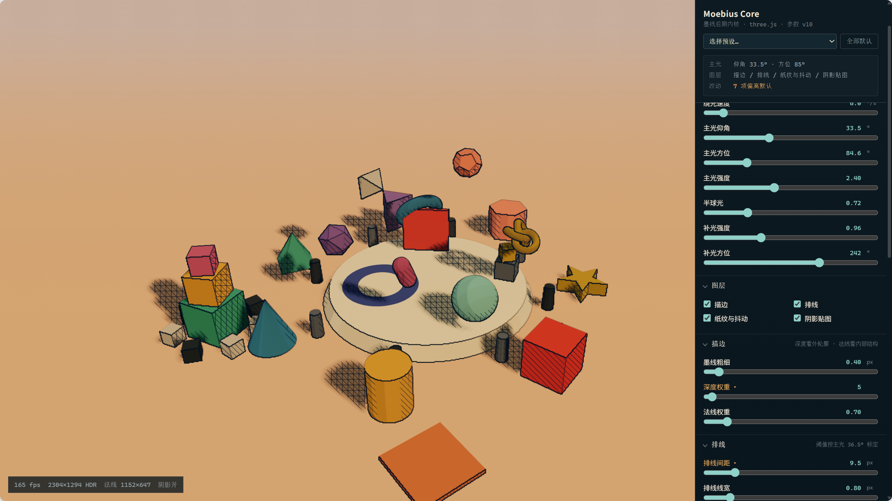
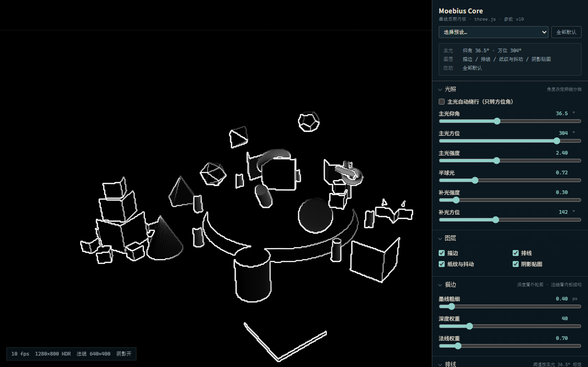
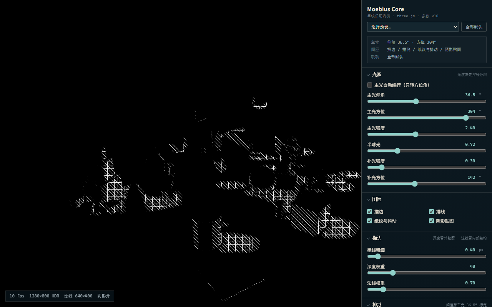
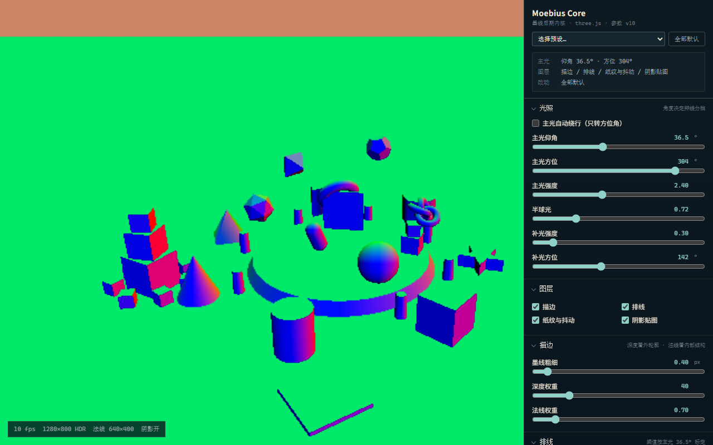
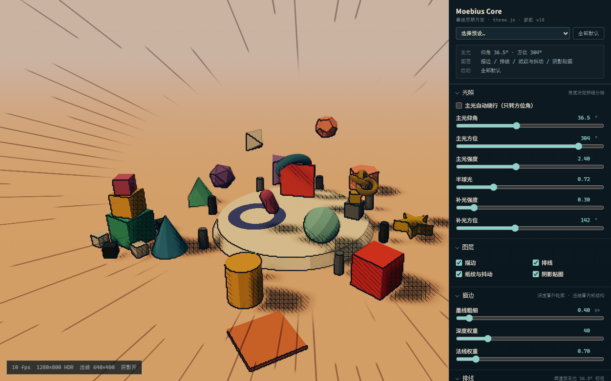
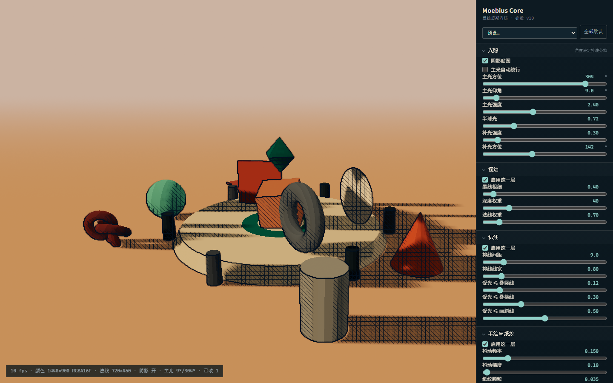
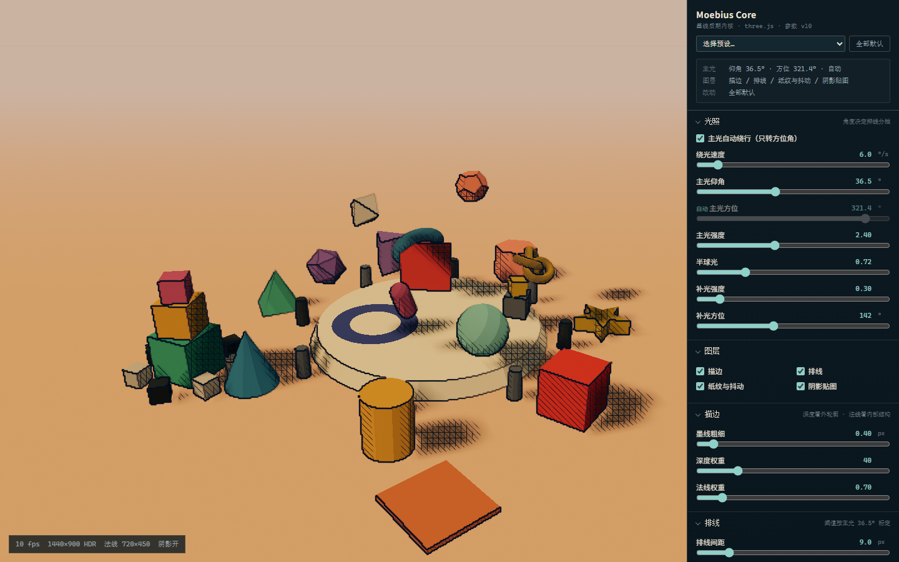

# Moebius Core

[](LICENSE)
[](https://threejs.org)
[](#limits)
[](#quick-start)

An ink-and-paper rendering core for three.js. Drop it over any scene and it becomes a drawn illustration: ink outlines, sun-keyed crosshatching, paper grain.



No build step, no dependencies beyond three.js. The pipeline is three passes over a hand-rolled post chain — not an EffectComposer wrapper.

## What it does

- **Outlines from depth, structure from normals.** A 3×3 Sobel runs on both buffers: depth finds silhouettes, normal luminance finds interior creases.
- **Hatching that reads light, not screen brightness.** Shading is bucketed by `max(0, N·L) × shadow mask`, written full-range into the normal buffer's alpha. Fog, exposure and tone mapping cannot shift a band.
- **Hand-drawn surface.** Per-pixel hash × low-frequency sine displaces both outline and hatching by the same field.
- **Three hatch bands.** Vertical, horizontal and diagonal strokes in CSS-pixel scale, so density never changes with device pixel ratio.
- **Half-resolution normal pass** with frame reuse while the image is still; smooth on motion, cheap at rest.
- **Speed streaks** driven by speed, acceleration, boost stage and braking, with the central 58% kept clear.
- **Inspectable.** Layer toggles and four diagnostic channels: outline mask, hatch mask, normals, depth.

| Outline mask | Hatch mask | Normal buffer | Speed streaks |
| --- | --- | --- | --- |
|  |  |  |  |

## Quick start

```shell
npm start          # → http://127.0.0.1:5180/
```

Attach it to a scene:

```js
import { createMoebiusPipeline } from './src/engine/moebius-pipeline.js';

const pipeline = createMoebiusPipeline(renderer, { scene, camera });
pipeline.prepareScene(scene);          // tag lines / points / sprites / transparents
pipeline.resize(width, height, ratio);

// per frame
pipeline.setDynamic({ speed, acceleration, time });
pipeline.render();                     // replaces renderer.render(scene, camera)
```

The core owns buffers, materials and passes. It does not own your scene, camera, lights or state — dynamic inputs are handed in each frame.

## The demo

A lit study bench: flat-bottomed solids resting exactly on the surface, non-flat ones suspended, arranged on concentric rings so no viewing angle self-intersects.

- Adjustable key light (azimuth, elevation, intensity), hemisphere and fill, with optional slow orbit.
- Elevation changes the hatching itself: at 36.5° flat ground stays clean, at 9° the whole sand plain gains strokes.
- Slider ranges are deliberately wide — 0 to exaggerated — because this bench exists to show what each parameter does.
- Six presets: default, line art, hatch only, heavy ink, low sun, overhead.





## Layout

```
src/engine/   reusable core — three.js only, copy the folder and it works elsewhere
src/demo/     the study bench: scene, light rig, panel, orbit camera
```

## Limits

- WebGL only. Software rasterizers fall back to no shadows and no MSAA.
- Assumes flat-shaded toon geometry. Outlines and hatching amplify weak geometry rather than hiding it.
- Large ground planes viewed at grazing angles will ink themselves if `depthWeight` is pushed to extremes — that is the depth-gradient criterion behaving as defined, not a bug.
- Per-material style roles (which materials may receive white specular dots) are not wired yet; the whole scene is treated uniformly.

## Documentation

Architecture and design contracts: [docs/ARCHITECTURE.md](docs/ARCHITECTURE.md). File map and change routing: [src/README.md](src/README.md). Maintainer index: [AGENTS.md](AGENTS.md).

## License

MIT — see [LICENSE](LICENSE). `vendor/three/` is three.js `0.180.0`, also MIT, with its license included.
